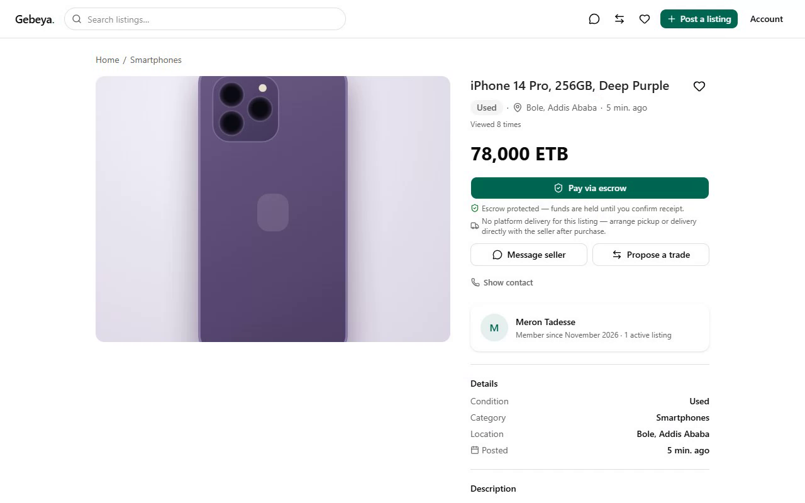
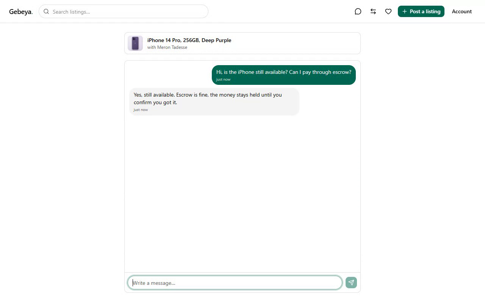
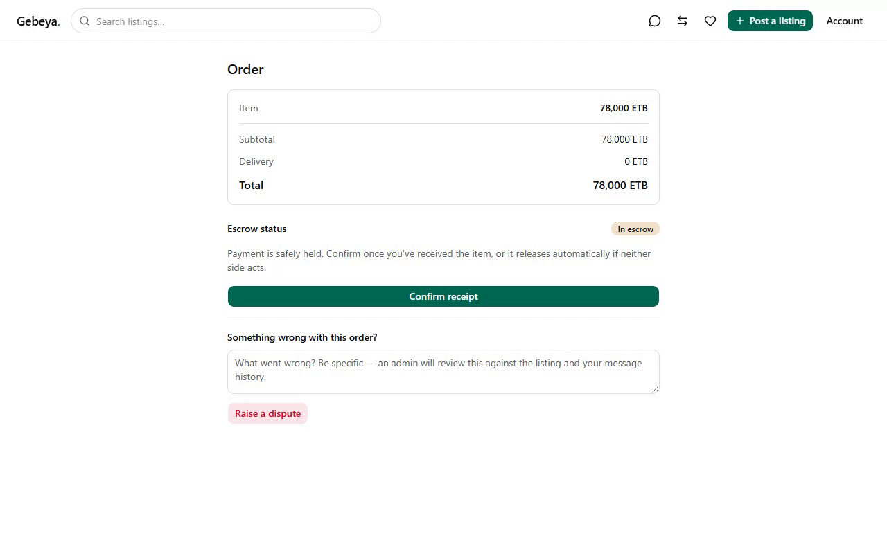
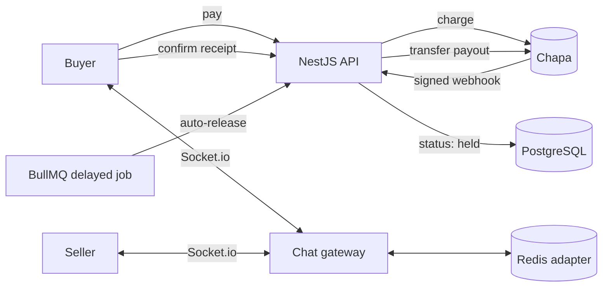

# Full-stack marketplace: escrow payments, real-time chat and auth (code excerpt)

Selected parts of a peer-to-peer marketplace I'm building, from the React screens to the database. The product itself lives in a private repository; this repo shows three of its hardest features end to end, copied as they are, with their tests.

**Stack:** React + TypeScript (Vite, Tailwind, shadcn/ui) on the frontend; NestJS (TypeScript), PostgreSQL with Drizzle ORM, Redis, BullMQ, Socket.io and the Chapa payment gateway on the backend; Jest with Testcontainers.

> This is an excerpt, so it doesn't build on its own: imports such as `orders`, `listings`, `reviews` and shared UI components point to code that isn't included. Code comments that reference `docs/...` point to the private design docs. A walkthrough of the full app is available on request.

| Listing with escrow | Live chat between buyer and seller | Order with payment held in escrow |
|---|---|---|
|  |  |  |

*Screenshots from a local run with demo accounts. The payment step was simulated in the local database, since Chapa's checkout needs a public webhook URL.*

## What's here

| Module | What it does |
|---|---|
| [`src/escrow`](src/escrow) | Holds a buyer's payment until they confirm receipt, with disputes, admin resolution and automatic release after a set window |
| [`src/chapa`](src/chapa) | Narrow client for the Chapa payment gateway (charge, verify, transfer) behind an interface, so tests use a fake |
| [`src/messaging`](src/messaging) | Real-time buyer-seller chat over Socket.io, with REST history endpoints |
| [`src/auth`](src/auth) | Phone sign-up with one-time codes, password login, Google and Facebook login, refresh-token rotation |
| [`db/schema`](db/schema) | The tables these modules use |
| [`frontend/src`](frontend/src) | The matching React screens: sign-up and login, paying via escrow, the order page with confirm-receipt and dispute, and live chat |
| [`test`](test) | 47 end-to-end tests for escrow, chat and auth against real Postgres and Redis (Testcontainers), plus 18 unit tests next to the code |

## Design decisions worth reading

**Escrow is a state machine, and money never touches a float.** An escrow moves only through `pending_payment → held → released | disputed`, then `disputed → released | refunded`, and only through one guarded transition helper that locks the row (`SELECT ... FOR UPDATE`) before checking the current state. Amounts are integer santim (`bigint`), and the platform fee is in basis points, computed at release time, not at payment time. See [`escrow.service.ts`](src/escrow/escrow.service.ts) and [`escrow-transactions.ts`](db/schema/escrow-transactions.ts).

**The payment is held in the platform balance, then paid out explicitly.** Splitting the charge to the seller's subaccount at payment time settles immediately, which defeats a hold. So the charge lands in the platform balance and the seller is paid by an explicit transfer call, recorded on the row, only when release actually happens.

**Webhooks are handled in a strict order.** Verify the signature on the raw body first, then deduplicate on the provider's event id with a unique constraint (not an "if it exists" check, which races), then process inside a transaction, and never trust the amount in the payload. The endpoint returns 2xx only after all of that succeeds, so a crash means the provider retries instead of the event being lost. See `handleWebhook` and [`chapa-webhook-events.ts`](db/schema/chapa-webhook-events.ts).

**Automatic release can't double-pay.** A delayed BullMQ job fires after the release window, takes the same row lock and re-checks that the escrow is still `held`, so a release racing with a buyer's dispute resolves to exactly one outcome. See [`auto-release.processor.ts`](src/escrow/auto-release.processor.ts).

**Chat authenticates before the socket exists.** The JWT check runs as Socket.io connection middleware, not in a connection hook, so a fast client can't send a message before verification finishes. It uses the same token verification as the HTTP API, and the Redis adapter lets chat work across several server instances. See [`messaging.gateway.ts`](src/messaging/messaging.gateway.ts) and [`redis-io.adapter.ts`](src/messaging/redis-io.adapter.ts).

**Refresh tokens rotate, and reuse revokes the whole family.** Each refresh issues a new token in the same family; presenting an already-used token is treated as theft and revokes every token in that family. A password reset revokes all sessions. One-time codes and refresh tokens are stored hashed, and phone numbers are normalized to E.164 at the edge so the same person can't create duplicate accounts. See [`auth.service.ts`](src/auth/auth.service.ts) and [`phone.util.ts`](src/common/phone/phone.util.ts).

## Frontend

**Tokens never sit in browser storage.** The access token lives only in memory, and the refresh token is an httpOnly cookie the JavaScript can't read. On page load the app silently refreshes from the cookie. When several requests hit an expired token at once, they share a single refresh call instead of each starting one, so token rotation on the backend never sees a false "reuse". See [`api-client.ts`](frontend/src/lib/api-client.ts) and [`auth-context.tsx`](frontend/src/lib/auth-context.tsx).

**Chat connects straight to the backend with the same token.** The chat panel opens the Socket.io connection with the in-memory access token in the handshake, which the backend checks before the socket exists. See [`chat-panel.tsx`](frontend/src/components/chat-panel.tsx) and [`messages-page.tsx`](frontend/src/pages/messages-page.tsx).

**The order page follows the escrow state.** It shows the escrow status, and the buyer's actions (confirm receipt, raise a dispute, leave a review) refetch the order afterwards, so the screen always reflects what the server decided. See [`order-detail-page.tsx`](frontend/src/pages/order-detail-page.tsx), [`pay-via-escrow-form.tsx`](frontend/src/components/pay-via-escrow-form.tsx) and [`dispute-form.tsx`](frontend/src/components/dispute-form.tsx).

## Tests

The end-to-end tests start real PostgreSQL and Redis containers and replace only the outside world (Chapa and SMS) with fakes in [`test/setup`](test/setup). They cover, among others: the full cycle from payment to webhook to `held` to confirmed receipt to `released`; a replayed webhook being processed once; a webhook whose amount doesn't match the order being rejected; two simultaneous receipt confirmations where exactly one wins; the reduced fee for business sellers; auto-release once the window passes; non-admins being blocked from resolving disputes; a chat socket with a missing or invalid token being refused; refresh-token reuse revoking the whole family; and two racing refreshes not revoking each other.

## License

Copyright (c) 2026 Yonas Mekonnen. All rights reserved. Shared publicly for review as a code sample; not licensed for reuse.
